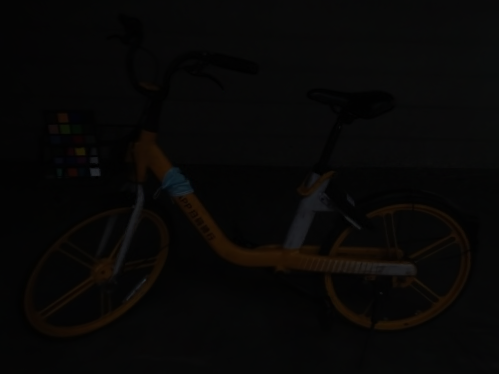
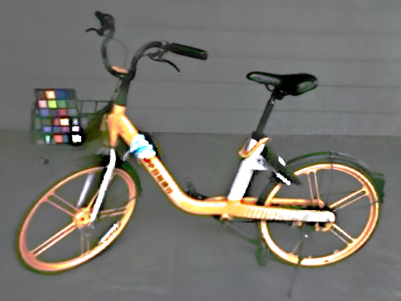
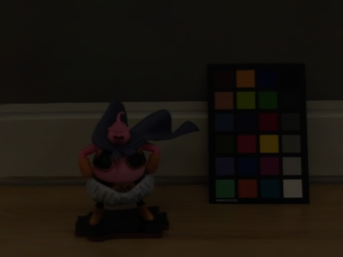
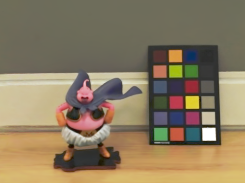
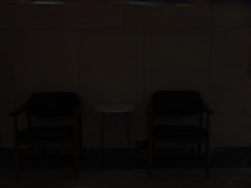
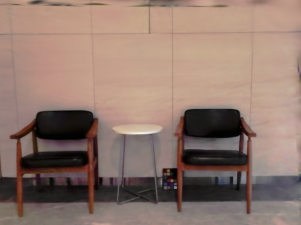
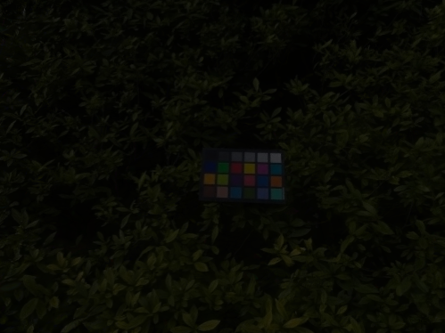
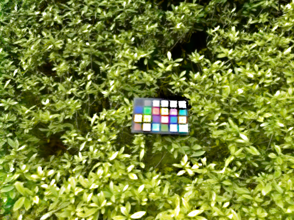
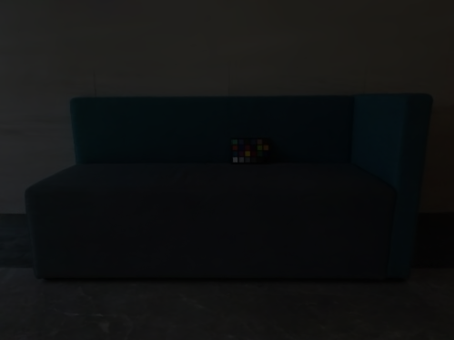
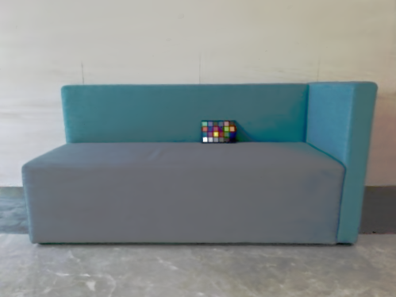

# GeoPE-GS: Geometry-Conditioned Pseudo-Enhancement for Low-Light 3D Gaussian Splatting

Official code for **GeoPE-GS: Geometry-Conditioned Pseudo-Enhancement for Low-Light 3D Gaussian Splatting**. The training entry point is [`examples/simple_trainer_ours.py`](examples/simple_trainer_ours.py).

> **Release status:** Code and [LOM low-light results](assets/experiments/LOM-lowlight/README.md) are available. Datasets can be obtained through [Luminance-GS](https://github.com/cuiziteng/Luminance-GS/blob/main/Luminance-GS/README.md). Pretrained weights are not currently available.

## Results

We provide rendering results, training configurations, and validation statistics for the five LOM low-light scenes: **bike, buu, chair, shrub, and sofa**. [Download all results (ZIP)](https://github.com/zxn2023/GeoPE-GS/raw/refs/heads/main/assets/experiments/GeoPE-GS-LOM-lowlight.zip), including all supplied evaluation stages, or browse the [result files and configurations](assets/experiments/LOM-lowlight/README.md).

The previews below show the **low-light branch render** and **enhanced branch render** for view `0000` at 10,000 training iterations (zero-based step `9999`). Both columns are model renders.

| Scene | Low-light render | Enhanced render |
| --- | --- | --- |
| [bike](assets/experiments/LOM-lowlight/bike) |  |  |
| [buu](assets/experiments/LOM-lowlight/buu) |  |  |
| [chair](assets/experiments/LOM-lowlight/chair) |  |  |
| [shrub](assets/experiments/LOM-lowlight/shrub) |  |  |
| [sofa](assets/experiments/LOM-lowlight/sofa) |  |  |

## Installation and Usage

The following instructions use **AutoDL / Ubuntu 22.04 / Python 3.10 / CUDA 11.8** as an example environment. An NVIDIA GPU, a compatible driver, and a CUDA toolkit that includes `nvcc` are required.

### 1. Check Your Environment

```bash
python --version
nvidia-smi
nvcc --version
```

Ensure that Python, the NVIDIA GPU driver, and the CUDA compiler are available.

### 2. Clone the Repository

The commands below use AutoDL's `/root/autodl-tmp` directory. On other servers, replace this path with your working directory.

```bash
cd /root/autodl-tmp
git clone --recurse-submodules https://github.com/zxn2023/GeoPE-GS.git
cd GeoPE-GS
```

If you have already cloned the repository, initialize the GLM submodule:

```bash
git submodule update --init --recursive
```

### 3. Install PyTorch and Dependencies

First, install PyTorch 1.13.1 with CUDA 11.7 support. Then install the project dependencies and the local gsplat package. See the [official PyTorch previous versions page](https://pytorch.org/get-started/previous-versions/) for installation commands.

```bash
python -m pip install torch==1.13.1+cu117 torchvision==0.14.1+cu117 torchaudio==0.13.1 --extra-index-url https://download.pytorch.org/whl/cu117
python -m pip install -r examples/requirements.txt
python -m pip install --no-build-isolation -e .
```

The final command compiles the CUDA extension included in this repository. After installation, verify your setup:

```bash
python -c "import torch, gsplat, gsplat.csrc; print('PyTorch:', torch.__version__); print('PyTorch CUDA:', torch.version.cuda); print('GPU available:', torch.cuda.is_available()); print('gsplat:', gsplat.__version__)"
```

`GPU available:` should be `True`, and `gsplat.csrc` should import successfully. For other CUDA environments, select a compatible PyTorch build.

### 4. Prepare the Data

The datasets used in this project can be obtained through the [dataset setup instructions in Luminance-GS](https://github.com/cuiziteng/Luminance-GS/blob/main/Luminance-GS/README.md):

- **LOM (low-light and overexposure):** Luminance-GS points to the [Aleth-NeRF dataset](https://github.com/cuiziteng/Aleth-NeRF). [Download LOM](https://drive.google.com/file/d/1orgKEGApjwCm6G8xaupwHKxMbT2s9IAG/view).
- **MipNeRF360-varying:** Use the [download provided by Luminance-GS](https://drive.google.com/file/d/1x0EHT5z9ZrA6JV7-y8A8ijQNFCRTjVMW/view?usp=sharing). This is a synthetic varying-lighting dataset based on MipNeRF360.

Please follow the original dataset providers' usage terms and citation instructions. The low-light example below uses LOM. Place the data under the repository's `data/` directory using the following structure. File and directory names are case-sensitive on Linux.

```text
GeoPE-GS/
├── data/
│   └── LOM_full/
│       └── buu/
│           ├── colmap_sparse/0/
│           ├── low/
│           ├── high/
│           ├── transforms_train.json
│           └── transforms_test.json
└── examples/
```

`low/` contains the low-light input images, and `high/` contains the reference images for evaluation. To use another low-light scene, replace `buu` in the commands below with the corresponding scene name.

### 5. Train GeoPE-GS on the LOM Low-Light Dataset

The following example trains GeoPE-GS on the `buu` scene:

```bash
cd /root/autodl-tmp/GeoPE-GS/examples
python simple_trainer_ours.py \
  --data_dir ../data/LOM_full/buu \
  --exp_name low \
  --result_dir ../results/LOM/buu_low \
  --max_steps 10000 \
  --batch_size 1
```

Outputs are saved to `--result_dir`, including the `ckpts/`, `stats/`, `renders/`, and `tb/` directories.

### 6. Evaluate an Existing Checkpoint

Use the `best.ckpt` checkpoint generated during training for evaluation and rendering:

```bash
cd /root/autodl-tmp/GeoPE-GS/examples
python simple_trainer_ours.py \
  --data_dir ../data/LOM_full/buu \
  --exp_name low \
  --result_dir ../results/eval/LOM/buu_low \
  --ckpt ../results/LOM/buu_low/ckpts/best.ckpt
```

### 7. Monitor Training with TensorBoard

Run the following command in another terminal during training. For remote access, forward port `6006` to your local machine.

```bash
cd /root/autodl-tmp/GeoPE-GS
tensorboard --logdir results/LOM/buu_low/tb --host 0.0.0.0 --port 6006
```

### Troubleshooting

- **`No module named gsplat`**: Return to the repository root and rerun the final installation command in Step 3.
- **`third_party/glm/glm/glm.hpp: No such file`**: Run `git submodule update --init --recursive` from the repository root, then reinstall the local extension.
- **`CUDA available: False` or compiler errors**: Check that the GPU driver, CUDA toolkit (`nvcc --version`), PyTorch CUDA build, and compiler are compatible.
- **`Image folder ... does not exist`**: Check the dataset directory structure in Step 4, including image filenames and capitalization.

To view all command-line options, run the following command from the `examples/` directory:

```bash
python simple_trainer_ours.py --help
```

## Code Map

| Path | Purpose |
| --- | --- |
| `examples/simple_trainer_ours.py` | GeoPE-GS training and evaluation |
| `examples/utils.py` | Geometry encoder and model utilities |
| `gsplat/rendering_double.py` | Dual-branch rasterization |
| `examples/datasets/` | Dataset loaders; the guide above covers LOM low-light training |

## Citation and Attribution

GeoPE-GS citation metadata will be added with the paper release. Until then, use the title above when referring to this implementation. If you use the underlying Luminance-GS method or dataset, cite its [paper and repository](https://github.com/cuiziteng/Luminance-GS). This code also incorporates [gsplat](https://github.com/nerfstudio-project/gsplat); see [NOTICE.md](NOTICE.md) and [LICENSE](LICENSE).
