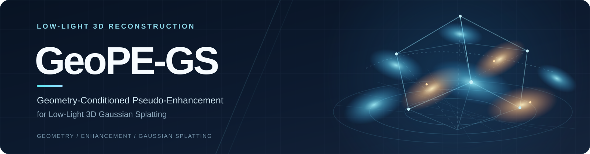

# GeoPE-GS: Geometry-Conditioned Pseudo-Enhancement for Low-Light 3D Gaussian Splatting



Official code for **GeoPE-GS: Geometry-Conditioned Pseudo-Enhancement for Low-Light 3D Gaussian Splatting**. The training entry point is [`examples/simple_trainer_ours.py`](examples/simple_trainer_ours.py).

> **Release status:** Code is available. Datasets and results will be shared separately. Pretrained weights are not currently available.

## 部署与使用

以下以 **AutoDL / Ubuntu 22.04 / Python 3.10 / CUDA 11.8** 为例。需要 NVIDIA GPU、兼容的驱动和包含 `nvcc` 的 CUDA toolkit。

### 1. 查看环境

```bash
python --version
nvidia-smi
nvcc --version
```

确认 Python、GPU 驱动和 CUDA 编译器可用。

### 2. 下载代码

以下使用 AutoDL 的 `/root/autodl-tmp` 目录；其他服务器请替换为实际工作目录。

```bash
cd /root/autodl-tmp
git clone --recurse-submodules https://github.com/zxn2023/GeoPE-GS.git
cd GeoPE-GS
```

已有仓库可运行以下命令补齐 GLM 子模块：

```bash
git submodule update --init --recursive
```

### 3. 安装 PyTorch 和依赖

先安装 PyTorch 1.13.1 + CUDA 11.7，再安装项目依赖和仓库内的 gsplat。PyTorch 安装命令见[官方历史版本说明](https://pytorch.org/get-started/previous-versions/)。

```bash
python -m pip install torch==1.13.1+cu117 torchvision==0.14.1+cu117 torchaudio==0.13.1 --extra-index-url https://download.pytorch.org/whl/cu117
python -m pip install -r examples/requirements.txt
python -m pip install --no-build-isolation -e .
```

最后一行会编译本仓库的 CUDA 扩展。安装后检查：

```bash
python -c "import torch, gsplat, gsplat.csrc; print('PyTorch:', torch.__version__); print('PyTorch CUDA:', torch.version.cuda); print('GPU available:', torch.cuda.is_available()); print('gsplat:', gsplat.__version__)"
```

`GPU available:` 应为 `True`，且 `gsplat.csrc` 应能成功导入。其他 CUDA 环境需选择兼容的 PyTorch 安装包。

### 4. 放置数据

数据集尚未随代码公开。低光数据放在仓库的 `data/` 目录，结构如下（Linux 区分文件名大小写）：

```text
GeoPE-GS/
├── data/
│   └── LOM_full/
│       └── buu/
│           ├── colmap_sparse/0/
│           ├── low/
│           ├── high/
│           ├── transforms_train.json
│           └── transforms_test.json
└── examples/
```

`low/` 是低光输入，`high/` 是评估参考图像。其他低光场景请替换命令中的 `buu`。

### 5. 训练 GeoPE-GS（LOM 低光，buu）

```bash
cd /root/autodl-tmp/GeoPE-GS/examples
python simple_trainer_ours.py \
  --data_dir ../data/LOM_full/buu \
  --exp_name low \
  --result_dir ../results/LOM/buu_low \
  --max_steps 10000 \
  --batch_size 1
```

结果写入 `--result_dir`，包括 `ckpts/`、`stats/`、`renders/` 和 `tb/`。

### 6. 用已有 checkpoint 评估

使用训练生成的 `best.ckpt` 评估并渲染：

```bash
cd /root/autodl-tmp/GeoPE-GS/examples
python simple_trainer_ours.py \
  --data_dir ../data/LOM_full/buu \
  --exp_name low \
  --result_dir ../results/eval/LOM/buu_low \
  --ckpt ../results/LOM/buu_low/ckpts/best.ckpt
```

### 7. 查看 TensorBoard

训练时可在另一个终端运行；远程访问需映射 6006 端口：

```bash
cd /root/autodl-tmp/GeoPE-GS
tensorboard --logdir results/LOM/buu_low/tb --host 0.0.0.0 --port 6006
```

### 常见问题

- `No module named gsplat`：回到仓库根目录，重新执行第 3 步最后一行。
- `third_party/glm/glm/glm.hpp: No such file`：回到仓库根目录，执行 `git submodule update --init --recursive`，然后重新安装本地扩展。
- `CUDA available: False` 或编译器报错：检查 GPU 驱动、`nvcc --version`、PyTorch CUDA 版本及编译器是否匹配。
- `Image folder ... does not exist`：核对第 4 步的数据目录、图像文件名和大小写。

完整命令行参数可在 `examples/` 下查看：

```bash
python simple_trainer_ours.py --help
```

## Code map

| Path | Purpose |
| --- | --- |
| `examples/simple_trainer_ours.py` | GeoPE-GS training and evaluation |
| `examples/utils.py` | Geometry encoder and model utilities |
| `gsplat/rendering_double.py` | Dual-branch rasterization |
| `examples/datasets/` | Dataset loaders; the guide above covers LOM low-light training |

## Citation and attribution

GeoPE-GS citation metadata will be added with the paper release. Until then, use the title above when referring to this implementation. If you use the underlying Luminance-GS method or dataset, cite its [paper and repository](https://github.com/cuiziteng/Luminance-GS). This code also incorporates [gsplat](https://github.com/nerfstudio-project/gsplat); see [NOTICE.md](NOTICE.md) and [LICENSE](LICENSE).
